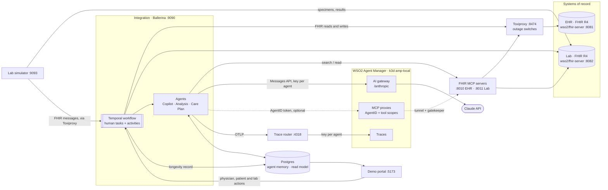

# EHR + Lab agentic integration

A longevity physician's journey that connects EHR history with lab biomarkers to catch risk early, built on
WSO2 integration technology:

- **Ballerina** services, with the official FHIR connector talking to the clinic's **EHR** and a reference lab (standing in for **Quest Diagnostics**), each its own FHIR R4 server; the lab simulator sends its specimens and results to the integration as **FHIR R4 messages** (to its `$process-message` operation, a FHIR service built on `health.fhirr4`), and both sides work in typed FHIR R4 resources (`health.fhir.r4`, `health.fhir.r4.international401`)
- one durable **Temporal workflow** per assessment (`ballerina/workflow`), whose waits on people are real **human tasks**
- **three Claude agents**, with read-only EHR access through the **WSO2 FHIR MCP server** and literature search through a **PubMed MCP server** (Ballerina, NCBI E-utilities)
- a **React portal**: a home page with the flow, and three apps that each open in their own tab — physician workspace (patient summary, EHR explorer, lab order, AI results analysis and release), patient app (optionally signing in with **SMART on FHIR** through **WSO2 API Manager** and the WSO2 Healthcare accelerator), and lab console (with the presenter's failure switches)
- realistic patient records generated with **Synthea**, with a curated storyline for the demo personas
- **WSO2 Agent Manager** governing the agents: an **AgentID** and **roles** per agent deciding which MCP tools it may call, Claude through the **AI gateway** with a key per agent and a **PHI-redaction guardrail**, every run **traced**, and **evaluation monitors** with built-in and custom evaluators — see [docs/agent-manager.md](docs/agent-manager.md)

The integration is the layer between the systems of record and the customer's own dashboards. It produces
the **Longevity Record**, the JSON that the physician and patient dashboards read.



## Prerequisites

- macOS. Everything runs in one **colima** VM: the demo's containers and, optionally, the Agent Manager cluster.
- `brew install colima docker docker-compose`
- An **Anthropic API key**
- Free host ports: 5173, 5433, 7233, 8010–8012, 8014, 8081, 8082, 8233, 8474, 9090, 9093, 4318. With Agent
  Manager, also 8080 and 8443.

You don't need Ballerina, Node or Java for a normal run. The images build inside the VM.

## Fresh run

```bash
cd use-cases/ehr-lab-agents
cp secrets.example.toml secrets.toml      # set anthropicApiKey
./scripts/up.sh                           # add --with-amp to include WSO2 Agent Manager
```

`scripts/up.sh` is the only script you need to start the demo. On a fresh clone it:

1. Checks `secrets.toml`. If the file is missing it creates it from the example, then stops so you can add the key.
2. Creates `config/patient-auth.json` from the example (the patient app starts in `normal` mode, with no sign-in).
3. Starts or creates the colima VM (profile `agent-manager`, 6 CPU / 10 GB / 120 GB). The size applies only when
   the VM is first created; override it with `COLIMA_CPU`, `COLIMA_MEMORY` and `COLIMA_DISK`.
4. Builds the images and starts Postgres.
5. On the first run, **loads the saved demo state** from `seed/snapshot/`: every FHIR store, the
   integration's database and Temporal's history, so finished assessments open with their workflow view.
6. Starts the whole stack and waits for `http://localhost:9090/api/health`.
7. With `--with-amp`, also installs WSO2 Agent Manager (about 15–20 minutes the first time), builds its
   gateway with the FHIR de-identification policy, registers the agents, adds the PHI guardrail and sets up the
   evaluation monitors. See [WSO2 Agent Manager](#wso2-agent-manager).

The first run takes a while: the images are built and the snapshot is restored.

### Check it works

| URL | What |
|---|---|
| http://localhost:5173 | Demo portal home: opens the physician workspace, patient app and lab console in new tabs |
| http://localhost:8233 | Temporal UI: every assessment as a durable workflow |
| http://localhost:9090/api/system | Integration API |
| http://localhost:9090/fhir/r4/Patient/{id}/$summary | Integration FHIR API: a patient's IPS (the lab posts its messages to `/fhir/r4/$process-message`) |
| http://localhost:8081/fhir/r4 · :8082 | EHR and lab FHIR servers |
| http://localhost:8474/proxies | Toxiproxy (what the outage switches change) |
| http://localhost:4318 | Trace router: traces forwarded per agent |
| http://console.amp.localhost:8080 | WSO2 Agent Manager console (admin / admin) → project *Longevity Clinic*; only with `--with-amp` |

For an end-to-end check, run one full assessment through the API. It makes real model calls (three or more):

```bash
./scripts/utils/smoke-test.sh                      # default: ehr p-sofia-alvarez
```

To walk through the journey in the portal, follow [docs/demo-script.md](docs/demo-script.md).

### Later runs

```bash
./scripts/up.sh             # keeps whatever data the demo has
./scripts/up.sh --restore   # discard the data and load seed/snapshot again
./scripts/up.sh --clean     # discard the data and load only the seed patients (no assessments)
```

To stop the stack, run `docker compose down` (the data volumes are kept) and `colima stop -p agent-manager`.

### Troubleshooting

- **"secrets.toml still has the placeholder key"**: put a real `anthropicApiKey` in `secrets.toml`.
- **"This data is from the two-EHR layout"**: the volumes are from an older version. Run `./scripts/up.sh --restore`.
- **"docker is not pointed at colima profile 'agent-manager'"** (Agent Manager scripts): run
  `docker context use colima-agent-manager`.
- **Changing the VM size after the first run**: don't. Resizing can break the Agent Manager cluster. Delete the
  profile and start again instead.

## Utility scripts

Everything apart from `up.sh` is in [`scripts/utils/`](scripts/utils/). Run them from the use-case root.
Each one prints its usage with `--help`.

**Stack and data**

| Script | What it does |
|---|---|
| `colima-up.sh` | Starts or creates the VM (`up.sh` runs it). Env: `COLIMA_PROFILE`, `COLIMA_CPU`, `COLIMA_MEMORY`, `COLIMA_DISK` |
| `reset.sh` | Clean slate: drops every volume, restarts, loads only the seed patients (`up.sh --clean` runs it) |
| `snapshot.sh [dir]` | Saves the current state as the seed (default `seed/snapshot/`). It stops the writers so the stores agree, and checks the dumps for API keys |
| `smoke-test.sh [ehr] [patientId]` | One full assessment through the API, as the portal does it |
| `host-mode.sh on\|off\|config\|status` | Runs the two Ballerina services on the Mac. See [Host mode](#run-the-ballerina-services-on-the-mac-host-mode) |
| `bal.sh <cmd>` | The Ballerina CLI from the pinned Docker image, for machines without Ballerina 2201.14.1 |

**WSO2 Agent Manager** (in the order `up.sh --with-amp` runs them, then the optional ones)

| Script | What it does |
|---|---|
| `amp-install.sh` | Installs Agent Manager 1.0.0 as the k3d cluster `amp-local` in the same VM |
| `amp-gateway.sh [--restore]` | Builds the gateway with the `mcp-fhir-deidentify` policy and switches Agent Manager to it (`--restore`: back to the stock gateway) |
| `amp-setup.sh` | Registers the agents: AgentIDs, roles, MCP proxies, model configurations, budgets and tracing keys. Writes the credentials into `secrets.toml` and `.amp/`. Flags: `--skip-llm-provider`, `--skip-mcp-proxies`, `--no-fhir-policy` |
| `amp-guardrails.sh` | PHI redaction on the AI gateway. Flags: `--verify`, `--remove`, `--provider <name>` |
| `amp-evaluations.sh` | Custom evaluators and a monitor per agent. Flags: `--backfill <hours>`, `--judge`, `--since/--until/--label`, `--rerun`, `--update-judge` |
| `amp-budgets.sh` | Applies per-agent budgets from `amp/budgets.json`. Flags: `--exhaust <agent>` (demo a refused call), `--off`, `--config` |
| `amp-openrouter.sh` | Adds an OpenRouter provider and per-agent model configurations. Needs `openrouterApiKey` in `secrets.toml` |
| `amp-models.sh claude\|openrouter` | Points the agents at one model configuration and restarts the integration. Flags: `--model <id>`, `--no-restart` |
| `amp-scores.sh [label…]` | Mean evaluation scores per agent and evaluator, one column per labelled review |

**Patient app sign-in** (optional; see [docs/smart-on-fhir.md](docs/smart-on-fhir.md))

| Script | What it does |
|---|---|
| `apim-setup.sh [install\|start\|configure\|stop\|status]` | WSO2 API Manager 4.3.0 and the Healthcare accelerator on the Mac. With no argument it installs, starts and configures |
| `patient-app-mode.sh smart\|normal\|status` | Switches the patient app between SMART on FHIR sign-in and no sign-in, with no rebuild |

## The journey

| # | Step | Who | Workflow |
|---|---|---|---|
| 1 | Find the patient in the EHR and open them: **International Patient Summary** (allergy banner, problems, medications incl. patient-reported, vitals with trends, results, immunizations, procedures, social and family history, rule-based flags, care gaps), past assessments, **EHR explorer** | Physician | — |
| 2 | Start the assessment: record pulled from the patient's EHR, visit opened there | Integration | activities |
| 3 | Explore the record (data types, date range, text, abnormal only), order labs from the lab catalog (the AI evaluation is hidden in the portal: `SHOW_AI_EVALUATION` in `EvaluationPanel.tsx`) | Physician | ⏸ **human task** (physician) |
| 4 | Order of record in the EHR, patient matched in the lab by MRN, order to the lab, **patient notified** (FHIR `Communication`) | Integration | activities |
| 5 | Patient sees "visit the lab" with preparation instructions; lab console → **Collect specimen** | Patient → Lab | ⏸ **human task** (patient; completed by the lab) |
| 6 | Lab processes; lab console → **Release results**: the lab sends a FHIR message with the DiagnosticReport and its Observations (fallback poller reads them from the lab's FHIR server) | Lab | ⏸ system event |
| 7 | Results filed in the EHR → **Results Analysis** → **Care Plan** → draft note in the EHR (preliminary) — unattended | Agents | activities |
| 8 | Physician reviews and **releases**: note final, visit closed, report published, patient sees it | Physician | ⏸ **human task** (physician) |

## How it is built, and why

| Decision | Why |
|---|---|
| **The EHR and the lab, each its own FHIR server** | The pitch is "we are the layer between the EHR and the lab". Each holds its own patient ids; the patient is matched in the lab by MRN, and every write for an assessment goes back to the EHR. |
| **Generic `health.clients.fhir` connector** (`ehrSystems` config, one EHR) | Same pattern as pa-policy-analyzer. Pointing at a real tenant — or adding another EHR — is configuration: base URL, client credentials, MRN system, MCP URL. |
| **The lab speaks FHIR, and the integration reads it typed** (`fhir_api.bal`, `lab_messages.bal`, `lab_client.bal`) | The lab simulator notifies the integration with FHIR R4 message Bundles (a MessageHeader, then the Specimen or the DiagnosticReport and its Observations), POSTed to FHIR's `$process-message` operation. The integration serves it with the FHIR service type (`health.fhirr4`), which checks the request is FHIR before the code runs, answers with a response message, and reports errors as OperationOutcomes. Both sides build and read every resource as `health.fhir.r4` / `health.fhir.r4.international401` types, so a malformed resource fails the build or is refused at the door. |
| **One Temporal workflow per assessment** (`workflow.bal`) | The journey spans minutes (physician) to days (patient, lab). Temporal persists each step, so a waiting assessment survives restarts — the crash switch proves it. |
| **Waits on people are human tasks** (`awaitHumanTask`) | Physician order, patient lab visit and physician release each have an audience (role) and an audit trail of who completed them; the lab's "results ready" is a system event, so it stays a data event. |
| **Retry, then ask a person** (`RetryBeforeReview`) | A system of record down for seconds is retried automatically; down for longer, a review is raised so operations can retry or stop — the assessment does not fail. |
| **Every side effect is an activity** (`activities.bal`) | The workflow function only sequences steps and waits, so Temporal can replay it without calling an EHR, the lab or the model twice. |
| **Idempotent writes** | A retried activity runs again from the top. Encounter, orders, the notification and the note are created once per business identifier; filed results use `ifNoneExist`. |
| **FHIR end to end** (`fhir_utils.bal`, `clinical_digest.bal`, `demo-portal/src/lib/fhir.ts`) | Clinical data is FHIR R4 everywhere: the integration reads with the Ballerina FHIR library's parser (`parser:parse`, against each type's base profile) and writes with its serializers. The portal API returns FHIR (Patient search Bundles, the patient summary as an IPS document with the rule-based flags as DetectedIssue and care gaps as proposed ServiceRequests, the explorer's resources, the lab order, Communication, Specimen and filed results); the workflow carries the same FHIR JSON between steps; the lab console API returns the lab's FHIR resources. The portal derives what it shows from them in `lib/fhir.ts`. |
| **Deterministic patient summary (IPS sections)** (`summary.bal`, `ips.bal`) | The physician must see exactly what the EHR holds. Flags are named rules (drug–allergy cross-reactivity, trends, ranges, family history, BP, BMI, smoking). An IPS FHIR document is composed when the EHR has no `$summary`; FHIR clients get it from the integration's own `GET /fhir/r4/Patient/{id}/$summary` (a `health.fhirr4` service). |
| **EHR explorer filters in the EHR** (`explorer.bal`) | One FHIR search per data type with the EHR's own date parameters; active problems and medications older than the range are brought in by a second, status-filtered search. |
| **Three agents, not more** (`agents.bal`) | Copilot = reasoning before the order (with the physician, in conversation); Analysis and Care Plan = reasoning after the results. Analysis and Care Plan stay separate although they run back to back: different readers, and the Care Plan agent has no EHR access — it may only use what the analysis established. |
| **Copilot outside the workflow, agents after results inside it** | The Copilot is a conversation (Postgres memory, many turns); only the physician's resulting order is a durable step. Analysis and Care Plan are activities: retries, timeouts, crash recovery. |
| **FHIR MCP server per EHR, read-only** | The Copilot and the Analyst can look up anything the physician did not select, in the patient's own EHR. Only `search`, `read` and `get_capabilities`; EHRs are changed only by activities. |
| **Draft note until released** | The AI-written note is filed as `preliminary`; it becomes `final` and reaches the patient only after the physician's release. |
| **Real failures, not flags** (Toxiproxy) | Outage switches disable a proxy, so the FHIR connector gets real connection errors and the retries, reviews and fallback poller the audience sees are the production code paths. |
| **Workflow view from `ballerina/workflow`'s management API** (`workflow_view.bal`) | Activity tree, human tasks and reviews come from the library; live retry attempts come from Temporal's describe API. |
| **Agent Manager governs, the integration still runs the agents** (`agent_manager.bal`) | The agents stay Temporal activities; Agent Manager adds who they are (AgentID), what they may call (MCP tool scopes) and spend (gateway key per agent), and what they did (traces) — without moving them into its runtime. |
| **Trace router** (`infra/trace-router`) | One process, three agents, one exporter: the router files each agent run under its own agent, and drops non-agent traces (pollers, reads) rather than charging them to an agent. |
| **Synthea + storyline** (`seed/synthea/`) | Synthea gives every patient years of realistic, coded history (SNOMED CT, LOINC, RxNorm, CVX). The storyline overlay fixes the personas' trends, conditions, medications, allergies and notes so the agents find the same story every run. |

## WSO2 Agent Manager

`scripts/utils/amp-install.sh` installs Agent Manager 1.0.0 as the k3d cluster `amp-local` in the same colima VM,
using AMP's own quick-start container (bash 5, k3d, kubectl, helm — nothing to install on the host).
`scripts/utils/amp-setup.sh` then registers project **Longevity Clinic** with three externally hosted agents and
writes what they were issued into a generated block of `secrets.toml` (and `.amp/`, both gitignored):

| Feature | How it is wired |
|---|---|
| **Agent identity** | Each agent has an **AgentID** (OAuth client in the environment's ThunderID). The FHIR and PubMed MCP servers sit behind **MCP proxies** secured by AgentID, a scope per tool group. Roles: `ehr-reader` (FHIR read tools → Copilot, Analyst), `literature-searcher` (PubMed → all three), `ehr-writer` (FHIR writes → nobody). The integration's `McpToolKit` gets its token by client credentials with the proxy as `resource`. |
| **FHIR de-identification** | `mcp-fhir-deidentify`, a custom gateway policy (`gateway/policies/`, built in by `scripts/utils/amp-gateway.sh`), on the FHIR MCP proxies: names, addresses, contact details and identifiers are removed, masked, pseudonymised or generalised in tool results, notes and billing are withheld, and searches by name, birth date or identifier are refused (rules: `amp/fhir-deidentify.json`). |
| **AI gateway** | LLM provider `anthropic` holds the Anthropic key. Each agent has its own model configuration (an LLM proxy with its own URL and key), so usage, limits and guardrails are per agent. |
| **Budgets and cost** | Per-agent US$/day and tokens/hour on each model configuration (`scripts/utils/amp-budgets.sh`, `amp/budgets.json`); over budget the gateway refuses the agent and the workflow step waits for operations to retry. The trace router prices every run with the gateway's price list: spend per agent, assessment and workflow step in the portal. |
| **Monitoring** | `ballerina/ai` emits GenAI spans (`invoke_agent`, `chat`, `execute_tool`); `ballerina/otel` exports them to `infra/trace-router`, which forwards each agent run with that agent's tracing key (Agent Manager attributes a trace by key; one process hosts three agents). |

Without `amp-setup.sh` the agents call Claude and the FHIR MCP servers directly; the portal says so.

**MCP proxies and the tunnel.** Agent Manager 1.0.0 only accepts MCP upstreams that resolve to a public
address, so it cannot reach the FHIR MCP servers on the VM directly. `amp-setup.sh` therefore starts the
`amp-tunnel` compose profile: a Cloudflare quick tunnel (no account) to `infra/mcp-gatekeeper`, an nginx that
rejects every request without the `X-Tunnel-Key` only Agent Manager's proxy sends. The data is synthetic, but
the tunnel URL is public while it runs. `./scripts/utils/amp-setup.sh --skip-mcp-proxies` leaves the agents on
direct MCP access (identity and traces still work).

**Workarounds for Agent Manager 1.0.0** (reported upstream): the host installer needs bash 4+ (macOS has
3.2), so the quick-start container is used; the gateway route caps requests at 30 s, so `amp-setup.sh` raises
it to 300 s for long Claude calls.

How it works and how to demo it: [docs/agent-manager.md](docs/agent-manager.md).

## Patient app: SMART on FHIR (optional)

By default the patient app has no sign-in. To have patients sign in with SMART on FHIR through WSO2 API
Manager and the Healthcare accelerator, you need the APIM 4.3.0 zip and Java 11, 17 or 21, then run:

```bash
APIM_ZIP=~/wso2/products/wso2am-4.3.0.zip ./scripts/utils/apim-setup.sh   # ~5 min; leaves the app in smart mode
./scripts/utils/patient-app-mode.sh normal                                # switch back
```

Set-up details, demo users, the sign-in flow and known limitations: [docs/smart-on-fhir.md](docs/smart-on-fhir.md).

## Data

`seed/snapshot/` is the saved demo state — every FHIR store, the integration's database (assessments, agent
memory, longevity records) and Temporal's history — so finished assessments open with their workflow view.
`up.sh` loads it on the first run (`seed/restore-snapshot.sh`); `scripts/utils/snapshot.sh` replaces it. The
images that wrote it are pinned by digest in `docker-compose.yml`.

`seed/ehr/` holds the EHR's committed transaction bundles (one per patient, plus the clinic's directory),
loaded by `seed/seed.sh`. They come from `seed/synthea/generate.sh`:

1. Synthea v4.0.0 (pinned, fixed seeds) generates 40 adults in each of two runs (Boston and Worcester, MA), for a varied population.
2. `transform.py` keeps the clinical record (8 years), drops billing, provenance and sensitive social-screening data, resolves Synthea's conditional references, rounds values to clinical precision, adds reference ranges, and picks the personas plus six other patients from each run — 16 patients in one EHR, sharing one MRN system.
3. `storyline.py` overlays each persona: identity, anchor visits with the trending labs and vitals, problems, medications (incl. history), allergies, family history and visit notes. Older Synthea results for the same tests are re-valued to lead into the story.

All patients are synthetic. Provider organizations and practitioners come from Synthea's public provider data.

## Project layout

```
ehr-lab-agents/
├── docker-compose.yml          all services
├── amp/                        Agent Manager evaluation config: evaluators/ (custom), monitors.json
├── docs/                       agent-manager.md · smart-on-fhir.md · demo-script.md
├── config/                     container configuration (no secrets); patient-auth.json: patient app mode + SMART settings
├── infra/                      Postgres, Toxiproxy, trace router, MCP gatekeeper, judge adapter
├── gateway/                    custom Agent Manager gateway policy (mcp-fhir-deidentify)
├── secrets.example.toml        copy to secrets.toml (gitignored)
├── seed/                       snapshot/ (saved state) · ehr/, lab-seed.json, seed.sh, restore-snapshot.sh
│   └── synthea/                generate.sh · transform.py · storyline.py
├── ehr_lab_physician/          Ballerina workspace
│   ├── ehr_agentic_integration/   workflow, activities, agents, explorer, IPS, workflow view, API
│   ├── lab_simulator/             the reference lab's back office; notifies the integration with FHIR messages
│   └── pubmed_mcp/                PubMed MCP server (literature search tool)
├── demo-portal/                React + Vite + Tailwind
└── scripts/
    ├── up.sh                   start everything, with data
    └── utils/                  everything else (see Utility scripts)
(.amp/, .apim/                  generated credentials and the APIM install; gitignored)
```

## Development

```bash
# Ballerina 2201.14.1 (or ./scripts/utils/bal.sh <cmd> to use the Docker image instead)
cd ehr_lab_physician/ehr_agentic_integration
bal test                                     # unit tests need the compose stack running

# Portal with hot reload against the running stack (stop the portal container first)
docker compose stop portal
cd demo-portal && npm install && npm run dev

# Regenerate the seed data (needs Java 17+; downloads Synthea once into seed/synthea/.cache)
./seed/synthea/generate.sh && ./scripts/utils/reset.sh
```

The integration's and the lab simulator's `Dependencies.toml` are committed and `sticky`. They pin
`ballerina/ftp` to 2.20.3: `health.clients.fhir` 3.0.6 needs `data.csv` 0.8.2, and the `ftp` bundled with
2201.14.1 needs `data.csv` 1.x. Without the pin, every rebuild after the first fails with "Incompatible
versions: ballerina/data.csv". Don't delete these files.

### Run the Ballerina services on the Mac (host mode)

To run or debug the two Ballerina services from WSO2 Integrator, use host mode. The integration and the
lab simulator then run on the Mac. Everything else stays in containers, including the PubMed MCP server.

```bash
./scripts/utils/host-mode.sh on       # write each package's Config.toml, stop both containers, point the rest at the Mac
# Open ehr_lab_physician/ in WSO2 Integrator and run ehr_agentic_integration and lab_simulator,
# or run `bal run` in each package directory.
./scripts/utils/host-mode.sh status
./scripts/utils/host-mode.sh off      # back to everything in containers (stop the local runs first)
```

`host-mode.sh on` generates the gitignored `Config.toml` files from `config/integration.toml`,
`config/lab-simulator.toml` and `secrets.toml`, swapping each container address for a host port. After
`amp-setup.sh` or `amp-models.sh` changes those files, run `./scripts/utils/host-mode.sh config`.

Host mode also sets `COMPOSE_FILE` in `.env`, so every `docker compose` command applies
[`docker-compose.host.yml`](docker-compose.host.yml) until host mode is switched off:

- The portal proxies `/api` and `/lab-api` to the Mac.
- EHR and lab-webhook traffic still goes through Toxiproxy, so the outage switches and webhook retries
  behave as they do in containers.
- The agents' OpenRouter calls reach Agent Manager through the LLM auth adapter, published on 127.0.0.1:8015.

Temporal holds the workflow state, so assessments that are already in flight carry on in whichever process
is running.

### Pointing at a real EHR

Edit its `[[ehrSystems]]` entry in `config/integration.toml`: `fhirBaseUrl`, `[ehrSystems.auth]` (token URL,
client id/secret, scopes) and `mrnSystem`. For its MCP server, set `FHIR_SERVER_BASE_URL` and the
`FHIR_SERVER_CLIENT_*` variables. The demo uses only standard FHIR R4 searches and writes.
